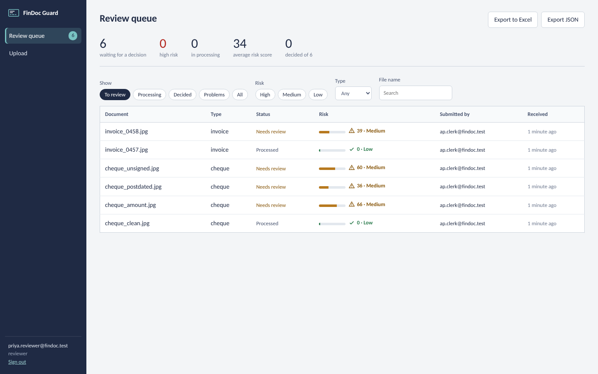
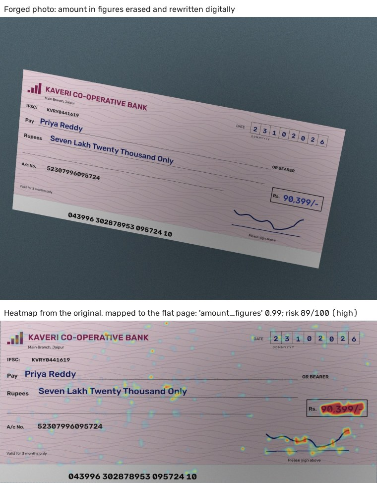
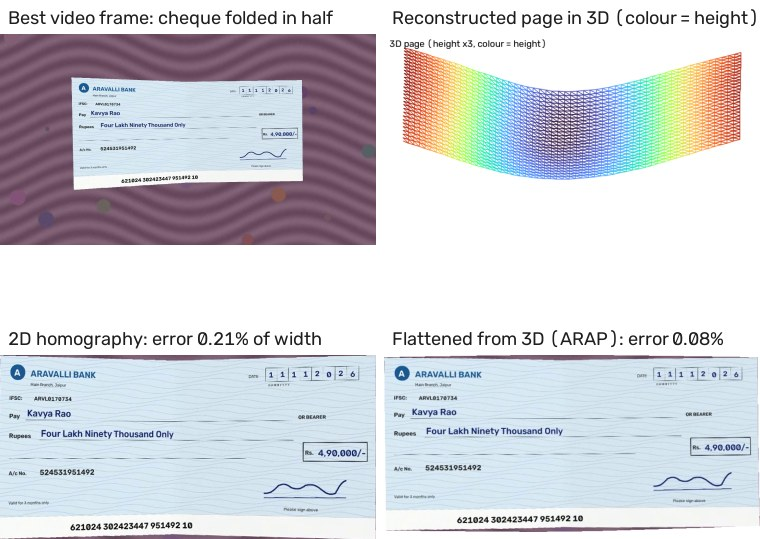
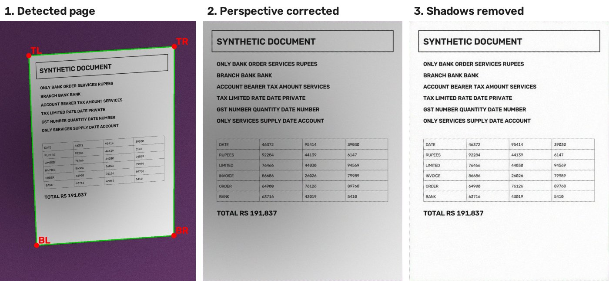
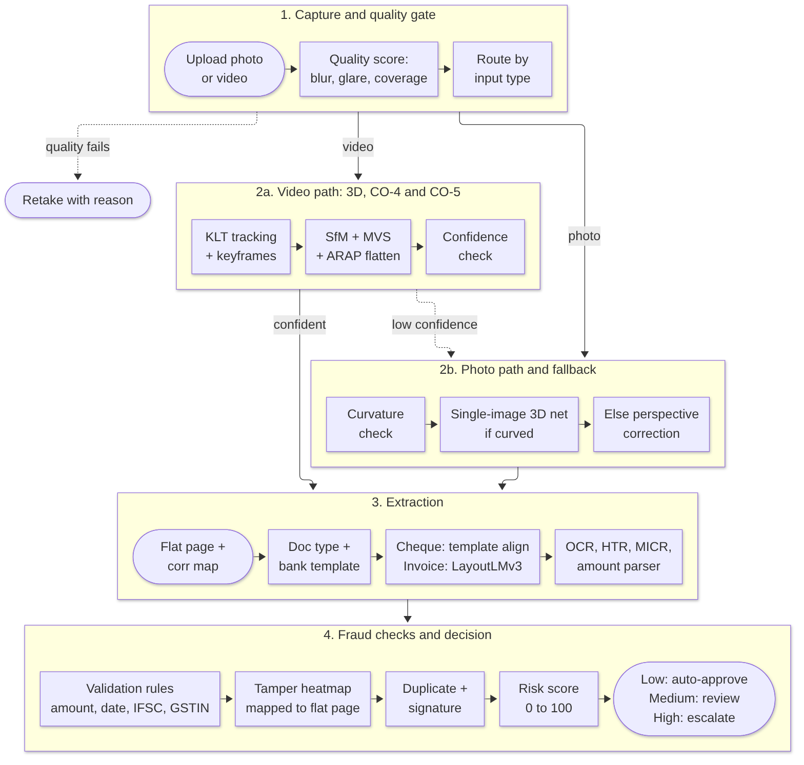

<div align="center">

# FinDoc Guard

**3D-aware cheque and invoice processing with explainable fraud detection**

[](https://github.com/AyushAg310/findoc-guard/actions/workflows/ci.yml)


</div>

FinDoc Guard turns a phone photo or a short video of a cheque or invoice into a validated,
structured record and an explainable fraud report. Its core contribution is a **multi-view 3D
reconstruction module** that flattens folded or curled documents before extraction, while
**preserving the forensic evidence** that tamper detection relies on.

> Computer Vision term project, LNMIIT Jaipur. Only synthetic or consented documents are used.

## Why

Banks and small businesses still key in cheques and invoices by hand. Phone capture makes it
worse: real documents are folded and crumpled, a flat perspective correction can't undo that,
and naive dewarping resamples the image in ways that erase tamper traces.

## Novelty

Existing work covers isolated tasks: LayoutLMv3 receipt extraction, cheque field localization,
document dewarping and tamper detection. FinDoc Guard unifies them into one deployable pipeline:
multi-view 3D reconstruction flattens folded documents while preserving forensic evidence,
template alignment handles cheques, LayoutLMv3 handles invoices, and Indian-format validation
feeds an explainable fraud score.

## Current capability (Phase 8)

**A web service and review desk (Phase 8).** Upload photos or videos from the browser or
through the REST API. Workers process them in the background, and the queue shows each
document's risk. A reviewer opens one and sees the page with every field box (colour = how
confident the reading was), the checks that fired with their reasons and points, and the
fields to correct. Clicking a flag lights up its region on the page. **A** approves, **R**
rejects and **E** escalates (an admin decides escalations), and everything goes into an
audit trail. Results export to Excel or JSON.



- **API:** FastAPI with OpenAPI docs at `/docs`. Authentication is by JWT for people and
  hashed API keys for systems. Roles are submitter, reviewer and admin, and other users'
  documents answer 404. Errors use RFC 9457 problem details. `/health` and Prometheus
  `/metrics` are included.
- **Jobs:** the PostgreSQL table is the queue (`FOR UPDATE SKIP LOCKED`), with 3 attempts,
  requeueing of jobs from crashed workers, and live stage progress.
- **Privacy:**
  - account numbers are masked in the API and covered in every rendered image;
  - uploads are re-encoded, which strips EXIF;
  - raw media is purged after 30 days;
  - documents are deleted on request.
- **Deploy:** run `docker compose up` for PostgreSQL, the API and N workers. On one machine,
  `findoc api serve` uses SQLite.

| Measured (PostgreSQL, CPU, EasyOCR) | Result |
| --- | --- |
| Cheque photo, upload to decision-ready | 2.3-2.6 s (target: 20 s on CPU) |
| Invoice photo | ~15 s (almost all full-page OCR) |
| Queue, 2 workers vs 1 (2-core sandbox, 24 cheques) | 1.73× faster |
| Lost or repeated jobs | none: every document processed exactly once |

## Earlier phases


**GST invoices (Phase 7).** An invoice photo is classified (cheque / invoice / receipt / other),
read, and its fields and line items are extracted: vendor, buyer, both GSTINs, invoice number,
date, the item table (description, HSN, quantity, rate, amount), subtotal, CGST/SGST or IGST,
and total. Then it's checked:

- **GSTIN**: format, state code and the official mod-36 check character;
- **arithmetic**: lines, subtotal, GST rate, CGST = SGST, total. It uses the invoice's own
  redundancy (sum of lines, amount in words) to tell an OCR misread from a wrong number;
- **tax type**: CGST + SGST within a state, IGST between states.

Extraction runs either rule-based (keyword anchors and table geometry, no training) or with
**LayoutLMv3** fine-tuned on synthetic Indian invoices (text + layout + image). Results export to
Excel (`findoc export`).

| Extraction, 90 synthetic invoices, OCR errors 0% / 1% / 3% | Header field F1 | Line-item cells |
| --- | --- | --- |
| Rules | 1.00 / 0.92 / 0.82 | 1.00 / 0.88 / 0.63 |
| LayoutLMv3 (fine-tuned on an RTX 3050, ~50 ms per invoice) | 1.00 / 0.95 / **0.86** | 1.00 / 0.98 / **0.93** |
| Real EasyOCR on 30 invoice photos, LayoutLMv3 | 0.94 | 0.95 |

| Invoice checks (40 per kind), OCR errors 0% / 1% | Result |
| --- | --- |
| Clean invoices sent to review | 0% / 15% |
| Wrong total, wrong line, wrong tax type caught | 100% / 88-98% |
| Invalid GSTIN sent to review | 90% / 90% |
| Real EasyOCR, 30 photos: clean sent to review / planted errors caught | 7% / 100% |

The [Phase 7 guide](docs/learn/phase-7-invoices.md#38-results-experimentsresultsphase7json) has
the 3% numbers, how the false alarms were brought down, and the GPU steps for LayoutLMv3.

**Fraud engine (Phase 6).** Three checks that consistent-looking fraud can't hide from, and one
explainable risk score:

- **Edited photo** (`TAMPER_REGION`): a small gradient-boosted model reads JPEG compression
  traces per 16x16 block **on the original capture**; its heatmap is then carried to the flat
  page through the same homography or 3D correspondence map, so dewarping never touches the
  evidence. The report names the field that was changed.
- **Duplicate presentation** (`DUPLICATE`): the handwriting left after template subtraction is
  matched (SIFT + RANSAC) against an index of cheques already seen.
- **Signature** (`SIGNATURE_MISMATCH`): shape descriptors compared with the account's reference
  signatures.
- **Risk score**: points x severity x confidence per fired check, capped at 100, with low /
  medium / high bands and every contribution listed.

<p align="center"></p>

Measured on synthetic captures ([`experiments/phase6_tamper_eval.py`](experiments/phase6_tamper_eval.py),
[`experiments/phase6_fraud_eval.py`](experiments/phase6_fraud_eval.py)):

| Tamper detection, 40 clean + 40 forged photos | Pixel AUC | Cheque AUC | Edited field named |
| --- | --- | --- | --- |
| Model on the **original, heatmap mapped** to the flat page | **0.953** | **0.956** | **97.5%** |
| Model trained on flat pages, run on the flat page | 0.858 | 0.923 | 90.0% |
| Untrained JPEG ghost, original + map / flat page | 0.707 / 0.602 | 0.446 / 0.398 | 20% / 8% |

| End to end | Result |
| --- | --- |
| Forged photos flagged / clean photos flagged | 77.5% / 0% (retype 100%, splice 69%, copy-move 62%) |
| Duplicate: second photo of a cheque matched / false matches | 20 of 20 / 0 of 82 |
| Signature: random / skilled forgeries caught; genuine sent to review | 100% / 87%; 13% |

On 6 bent-cheque videos the mapped heatmap also wins on pixel AUC (0.77 vs. 0.72), but that's
too few videos for a cheque-level conclusion. All forgeries and signers are synthetic; the
[Phase 6 guide](docs/learn/phase-6-fraud-engine.md#38-results) explains the limits.

**Folded and curled cheques flattened in 3D (Phase 5).** From a few seconds of video, the
document's 3D shape is reconstructed (structure from motion: SIFT, essential matrix and
homography initialisation, PnP, bundle adjustment with focal-length search), a smooth surface is
fitted to the page, and the surface is unrolled flat with ARAP, the way paper actually unbends.
Flat pages are recognised first and keep the exact 2D homography.

<p align="center"></p>

Measured on 15 synthetic hand-held videos with exact ground truth (4 s, 1280x720; error left
after the best homography to the true flat cheque, % of cheque width;
[`experiments/phase5_recon_eval.py`](experiments/phase5_recon_eval.py)):

| Bend | 2D homography | 3D, focal estimated | 3D, calibrated camera |
| --- | --- | --- | --- |
| Flat | 0.244% | kept 2D (correct) | kept 2D |
| Wave | 0.397% | 0.270% | 0.277% |
| Curl (one end) | 0.170% | 0.166% (2 of 3 judged flat) | 0.163% |
| Curl (both ends) | 0.376% | 0.258% | 0.276% |
| Fold | 0.179% | **0.072%** | 0.094% |

3D adds 15-55 s per clip on a laptop CPU, about a third of that once the phone is calibrated
with a printed checkerboard (`findoc calibrate`). How the result went from losing to 2D to
winning (a biased metric, then an ARAP solver stopped too early) is in the
[Phase 5 guide](docs/learn/phase-5-3d-reconstruction.md#39-results-experimentsphase5_recon_evalpy).

**Page detection that doesn't depend on the background (Phase 4).** Real phone videos showed the
classical detector failing on a pale wooden board (it outlined the whole board) and on patterned
cloth. A small U-Net, trained only on synthetic images with deliberately hard backgrounds and
run through OpenCV DNN (no PyTorch needed at runtime), now finds the page; the classical
detector remains as a fallback.

Measured on 320 hard synthetic images (1280x720, unseen documents) plus 160 where the page runs
off the frame ([`experiments/phase4_segmentation_eval.py`](experiments/phase4_segmentation_eval.py)),
model trained in 55 min on an RTX 3050 laptop GPU (validation IoU 0.993):

| Metric | Classical | Learned |
| --- | --- | --- |
| Page found (corners within 2% of the diagonal) | 45% | 96% |
| ... on a near-white table / bright board / white-text poster | 5% / 8% / 25% | 100% / 88% / 100% |
| Corner error when found (% of diagonal) | 0.56% | 0.14% |
| Cut-off page wrongly called whole | 0% | 0% |

On three real phone videos, the learned detector processes the one filmed correctly (whole
cheque on a pale wooden board: 102 of 137 frames usable, 7 keyframes, rectified to 2.28:1, a
standard cheque is 2.21:1), which the classical detector rejected, and still rejects the two
where the cheque runs off the frame.

**Video (Phase 3).** Film the cheque for a few seconds instead of taking a photo. The document is
tracked through every frame with KLT optical flow (Shi-Tomasi corners, pyramidal Lucas-Kanade,
forward-backward check, RANSAC homography, drift correction and SIFT re-localisation when it
leaves the view). The sharpest, most head-on frame goes to the cheque pipeline, and a set of
sharp keyframes from spread-out viewpoints is kept for 3D reconstruction (Phase 5):

<p align="center"></p>

Measured on 18 synthetic hand-held clips (4 s, 1280x720) with exact ground truth: clean, a thumb
covering a corner, and the camera panning away and back
([`experiments/phase3_tracking_eval.py`](experiments/phase3_tracking_eval.py)):

| Metric | Result |
| --- | --- |
| Corner error, clean / thumb / pan-away (% of frame diagonal) | 0.14% / 1.34% / 0.26% |
| In-view frames tracked through pan-away and back | 99.5% |
| Keyframes blurred > 3 px (selected vs. evenly spaced) | 0% vs. 18.5% |
| Bank identified on the selected frame vs. first / random frame | 100% vs. 22% / 44% |
| Field accuracy with real OCR (EasyOCR, RTX 3050, v0.4.0) on selected vs. first / random frame | 94.4% vs. 19.0% / 44.4% |
| Processing time for a 4 s clip (laptop CPU, no OCR) | ~2.6 s |

On these clips a per-frame page detector is as accurate as tracking (0.14% on clean clips), so
tracking is not claimed to be more accurate. Its value is consistent outlines across frames for
keyframe selection, recovery when the edges are hidden or out of view, and the point tracks
Phase 4 needs ([discussion](docs/learn/phase-3-video-tracking.md#39-experimentsphase3_tracking_evalpy-results)).

**Cheques (Phase 2).** A cheque photo is matched to its bank's template with SIFT features and a RANSAC
homography, every field box is placed, the pre-printed template is subtracted so only the
writing remains, and each field is read, parsed and checked:

<p align="center"></p>

Checks so far: amount in words vs. figures (Indian lakh/crore system), stale and post-dated
cheques (RBI 3-month validity), IFSC / account / MICR format, missing signature.

Measured on 120 synthetic cheque photos from four fictional banks
([`experiments/phase2_cheque_eval.py`](experiments/phase2_cheque_eval.py)):

| Metric | Result |
| --- | --- |
| Bank template identification | 100% |
| Field-box IoU vs. ground truth (mean / worst) | 0.995 / 0.982 |
| Signature presence | 100% |
| Median template matching time (4 templates, laptop CPU) | ~0.2 s |

With **real OCR** (EasyOCR on an RTX 3050 laptop GPU, 100 cheques, v0.3.2):

| Metric | Result |
| --- | --- |
| Field accuracy: date, payee, amount in words and figures, account, IFSC, MICR | 100% each |
| Fraud recall: amount mismatch / stale / post-dated / unsigned | 100% each |
| Clean cheques with any flag (false alarms) | 0% |
| Field reading time per cheque (GPU) | ~0.5 s |

Getting the boxed date digits right took an ablation: read as written 96%, re-spaced 45% (the
recogniser splits the slashed zero into "0" + "8"), digit by digit 100%. The pipeline tries them in
turn and keeps the first valid calendar date
([ablation](experiments/date_reading_ablation.py), v0.3.0: 94% date accuracy, 8% false alarms).
A simulated-OCR sweep shows how errors would hurt: at a 2% character error rate fraud recall stays
high but false alarms rise, mostly from a misread digit looking like an altered amount, which is
why the Phase 6 risk score weights every check by OCR confidence
([details](docs/learn/phase-2-cheques.md#312-experimentsphase2_cheque_evalpy-results)).

**Any document (Phase 1).** Quality gate, page detection, perspective correction, shadow removal
and OCR: 100% page detection and 0.10% mean corner error on 200 synthetic photos
([details](docs/learn/phase-1-flat-photo.md#311-experimentsphase1_detection_evalpy-measuring-the-pipeline)).

<p align="center"></p>

Synthetic data is easier than real photos; real-capture results will be added in Phase 9.

## Architecture

<p align="center"></p>

<details>
<summary>End-to-end processing flow</summary>
<p align="center"></p>
</details>

<details>
<summary>3D reconstruction and flattening module (CO-5)</summary>
<p align="center"></p>
</details>

Full requirements and design: [`docs/FinDoc_Guard_SRS_SDD.pdf`](docs/FinDoc_Guard_SRS_SDD.pdf).

**Learning guide:** every file is explained, phase by phase, in [`docs/learn/`](docs/learn/README.md).

## Course outcome coverage

| CO | Outcome | Where it's applied |
| --- | --- | --- |
| CO-1 | Image acquisition and processing | Quality scoring, document detection, rectification, illumination correction |
| CO-2 | Deep learning architectures | U-Net document segmentation, LayoutLMv3, handwriting OCR, single-image 3D dewarping, tamper forensics |
| CO-3 | Feature detection and matching | SuperPoint + LightGlue, template alignment, duplicate search |
| CO-4 | Motion estimation and tracking | KLT tracking, keyframe selection from video |
| **CO-5** | **3D reconstruction** | **SfM, MVS, meshing, ARAP flattening, forensic evidence mapping** |

## Roadmap

Each phase is a working, demoable increment released as a new minor version.

| Phase | Version | Adds | Status |
| --- | --- | --- | --- |
| 0 | 0.1 | Scaffold: package, CLI, tests, CI, Docker | ✅ Done |
| 1 | 0.2 | Flat-photo pipeline: quality gate, detection, rectification, OCR | ✅ Done |
| 2 | 0.3 | Cheque understanding: templates, field recognition, amount-in-words, rules | ✅ Done |
| 3 | 0.4 | Video + KLT tracking + keyframe selection | ✅ Done |
| 4 | 0.5 | Learned page detection: U-Net document segmentation trained on synthetic hard backgrounds, ONNX | ✅ Done |
| 5 | 0.6 | 3D reconstruction: SfM, surface fit, ARAP flattening, camera calibration | ✅ Done |
| 6 | 0.7 | Fraud engine: tamper mapping, duplicates, signature, risk score | ✅ Done |
| 7 | 0.8 | Invoices: classifier, rules + LayoutLMv3 extraction, GSTIN, invoice arithmetic, Excel export | ✅ Done |
| 8 | 0.9 | Product: FastAPI, PostgreSQL, workers, React review UI, Docker Compose | ✅ Done |
| 9 | 1.0 | Evaluation, ablations, demo video, term paper | ⏳ Next |

Phase 4 was added after real phone videos showed that classical page detection depends on the
background (it failed on a pale wooden board and on patterned cloth); 3D reconstruction moved to
Phase 5.

## Quick start

```bash
git clone https://github.com/AyushAg310/findoc-guard.git
cd findoc-guard
python -m venv .venv
# Windows: .venv\Scripts\activate    macOS/Linux: source .venv/bin/activate
pip install -e ".[dev,ui]"        # add ",ocr" for text recognition (installs PyTorch)

findoc --help
findoc process data/samples/synthetic_cheque_mismatch.jpg --save-dir outputs
findoc process data/samples/synthetic_shadow.jpg --save-dir outputs --out outputs/result.json
findoc synth --kind cheque --n 20  # synthetic cheque photos with ground truth
findoc synth --kind video --n 1 --seed 3 -o data/synthetic/video   # hand-held cheque video
findoc process data/synthetic/video/video_0003.mp4 --save-dir outputs   # tracking + keyframes
pip install -e ".[train]"         # PyTorch + onnx, only to train the page detector
findoc segment train              # ~55 min on a laptop GPU; writes models/docseg.onnx
findoc segment check photo.jpg    # what the page detector sees
findoc synth --kind video --n 1 --seed 4 --bend fold -o data/synthetic/fold   # folded cheque
findoc process data/synthetic/fold/video_0004.mp4 --save-dir outputs   # 3D: points, mesh, flat page
findoc calibrate board.mp4 --save # phone focal length from a printed checkerboard (faster 3D)
findoc tamper train               # ~5 min on a CPU; writes models/tamper.pkl
findoc classify train             # ~2 min on a CPU; cheque / invoice / receipt / other
findoc synth --kind invoice --n 5 # GST invoice photos with ground truth
pip install -e ".[layout]" && findoc invoice train   # LayoutLMv3 on a GPU (~21 min, 2 epochs)
findoc process invoice.jpg --out outputs/inv.json && findoc export outputs/*.json --out invoices.xlsx
findoc process cheque.jpg --register            # check, then add to the duplicate index
findoc signatures add 123456789012 ref1.jpg ref2.jpg   # reference signatures of an account
findoc process cheque.jpg --account 123456789012 --save-dir outputs   # + signature check
findoc templates list
streamlit run demo/streamlit_app.py
pytest
```

For GPU OCR on Windows with an NVIDIA card, install the CUDA build of PyTorch first
(see [pytorch.org](https://pytorch.org/get-started/locally/)), then `pip install -e ".[ocr]"`.

### The web service (Phase 8)

On one machine (SQLite, a worker thread inside the server):

```bash
pip install -e ".[api,ocr]"
cd frontend && npm ci && npm run build && cd ..      # the review UI (Node 18+)
findoc api create-user --email you@example.com --role admin
findoc api serve                                      # http://127.0.0.1:8000 (API docs: /docs)
```

The full stack with Docker (PostgreSQL, API, workers):

```bash
cp .env.example .env          # set the passwords and the JWT secret
docker compose up --build     # http://localhost:8000, admin from .env
docker compose up --scale worker=3
```

For UI development, run `npm run dev` in `frontend/` (http://localhost:5173). It sends API calls
to `findoc api serve`.

The CLI in Docker:

```bash
docker build -t findoc-guard .
docker run --rm -v "$PWD:/work" -w /work findoc-guard process data/samples/synthetic_tilted.jpg --no-ocr
```

## Project structure

```
findoc-guard/
├── findoc/              # Core library
│   ├── pipeline.py      # Stage-based pipeline and process() entry point
│   ├── types.py         # Document, Field, CheckResult models
│   ├── cli.py           # `findoc` command-line tool
│   ├── preprocess/      # Phase 1  quality, detection, rectification   (CO-1)
│   ├── segment/         # Phase 4  learned page detection: U-Net, ONNX inference (CO-2)
│   ├── recognize/       # Phase 1-2 OCR, handwriting, MICR, amount parser
│   ├── classify/        # Phase 7  document-type classifier (cheque/invoice/receipt/other)
│   ├── localize/        # Phase 2  cheque templates, SIFT + RANSAC registration (CO-3)
│   ├── track/           # Phase 3  KLT tracking, keyframes              (CO-4)
│   ├── recon3d/         # Phase 5  SfM, surface fit, ARAP flattening, calibration (CO-5)
│   ├── fraud/           # Phase 2  rules; Phase 6 tamper, duplicates, signature, risk score
│   └── export/          # Phase 7  Excel export
├── app/                 # Phase 8  FastAPI service: routers, models, auth, job worker
├── frontend/            # Phase 8  React + TypeScript review UI (Vite)
├── data/                # Synthetic generators and samples (no real documents)
├── experiments/         # Evaluation configs and notebooks
├── docs/                # SRS/design document and diagrams
└── tests/
```

## Tech stack

Python · OpenCV · PyTorch · Hugging Face Transformers (LayoutLMv3) · SciPy (bundle adjustment, ARAP) · scikit-learn (tamper model) · SuperPoint + LightGlue · EasyOCR / PaddleOCR · FastAPI · SQLAlchemy · PostgreSQL ·
React + TypeScript (Vite) · Docker Compose · GitHub Actions

## Responsible use

This is a decision-support tool: a human reviewer makes the final decision. Fraud scores can be
wrong, so every flag shows its evidence and confidence. Only synthetic or consented documents
are processed or stored.

## License

[MIT](LICENSE)
