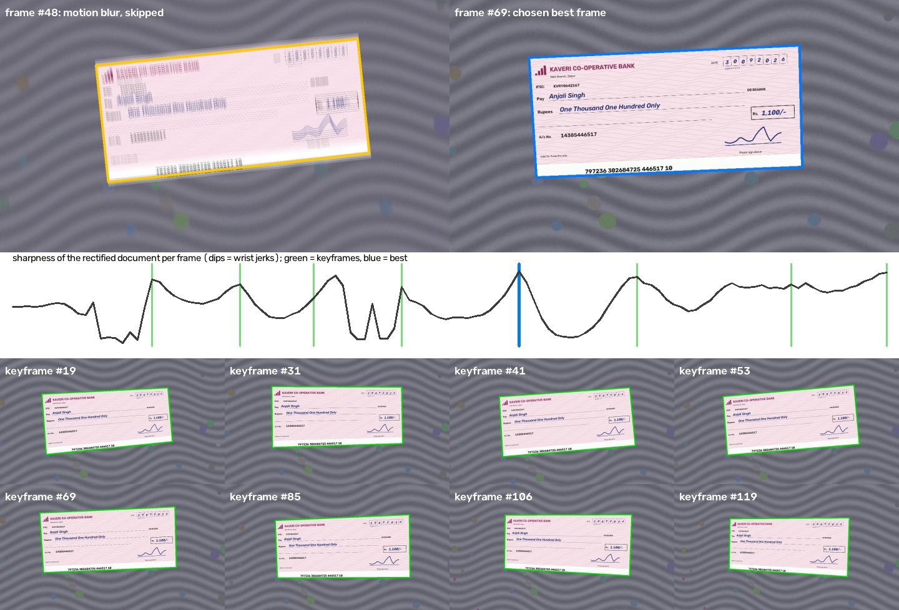
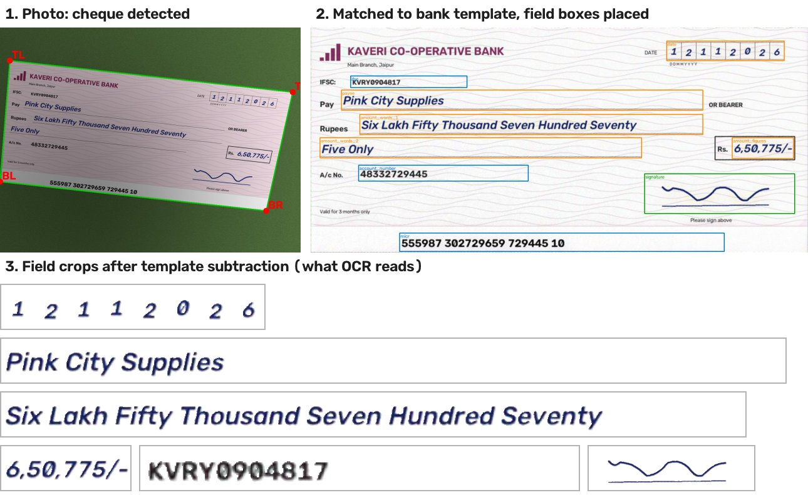
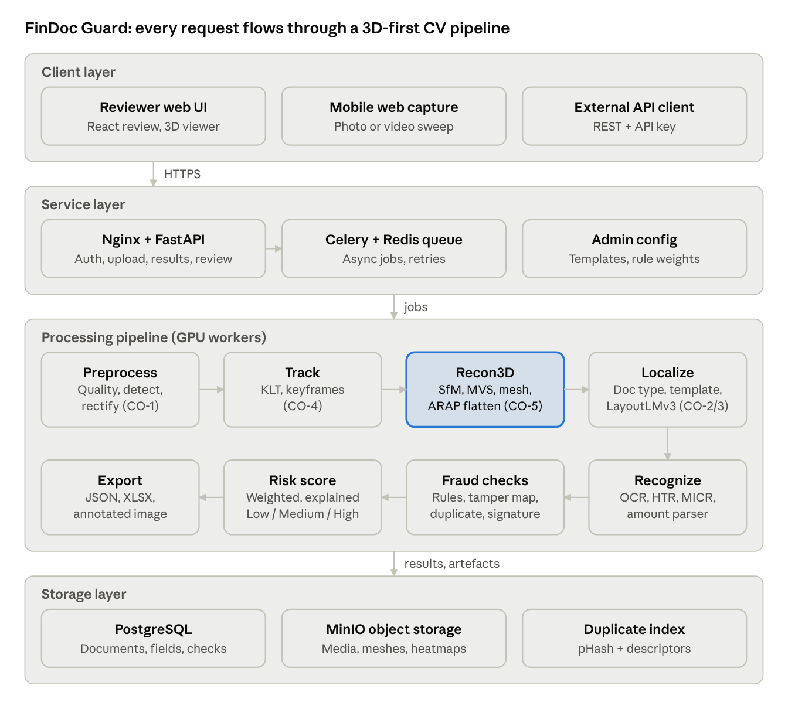

<div align="center">

# FinDoc Guard

**3D-aware cheque and invoice processing with explainable fraud detection**

[](https://github.com/AyushAg310/findoc-guard/actions/workflows/ci.yml)


</div>

FinDoc Guard turns a phone photo or a short video of a cheque or invoice into a validated,
structured record and an explainable fraud report. Its core contribution is a **multi-view 3D
reconstruction module** that flattens folded or curled documents before extraction, while
**preserving the forensic evidence** that tamper detection relies on.

> Computer Vision term project, LNMIIT Jaipur. Only synthetic or consented documents are used.

## Why

Banks and small businesses still key in cheques and invoices by hand. Phone capture makes it
worse: real documents are folded and crumpled, a flat perspective correction can't undo that,
and naive dewarping resamples the image in ways that erase tamper traces.

## Novelty

Existing work covers isolated tasks: LayoutLMv3 receipt extraction, cheque field localization,
document dewarping and tamper detection. FinDoc Guard unifies them into one deployable pipeline:
multi-view 3D reconstruction flattens folded documents while preserving forensic evidence,
template alignment handles cheques, LayoutLMv3 handles invoices, and Indian-format validation
feeds an explainable fraud score.

## Current capability (Phase 3)

**Video (Phase 3).** Film the cheque for a few seconds instead of taking a photo. The document is
tracked through every frame with KLT optical flow (Shi-Tomasi corners, pyramidal Lucas-Kanade,
forward-backward check, RANSAC homography, drift correction and SIFT re-localisation when it
leaves the view). The sharpest, most head-on frame goes to the cheque pipeline, and a set of
sharp keyframes from spread-out viewpoints is kept for 3D reconstruction (Phase 4):

<p align="center"></p>

Measured on 18 synthetic hand-held clips (4 s, 1280x720) with exact ground truth: clean, a thumb
covering a corner, and the camera panning away and back
([`experiments/phase3_tracking_eval.py`](experiments/phase3_tracking_eval.py)):

| Metric | Result |
| --- | --- |
| Corner error, clean / thumb / pan-away (% of frame diagonal) | 0.14% / 1.34% / 0.26% |
| In-view frames tracked through pan-away and back | 99.5% |
| Keyframes blurred > 3 px (selected vs. evenly spaced) | 0% vs. 18.5% |
| Bank identified on the selected frame vs. first / random frame | 100% vs. 22% / 44% |
| Field accuracy with real OCR (EasyOCR, RTX 3050, v0.4.0) on selected vs. first / random frame | 94.4% vs. 19.0% / 44.4% |
| Processing time for a 4 s clip (laptop CPU, no OCR) | ~2.6 s |

On these clips a per-frame page detector is as accurate as tracking (0.14% on clean clips), so
tracking is not claimed to be more accurate. Its value is consistent outlines across frames for
keyframe selection, recovery when the edges are hidden or out of view, and the point tracks
Phase 4 needs ([discussion](docs/learn/phase-3-video-tracking.md#39-experimentsphase3_tracking_evalpy-results)).

**Cheques (Phase 2).** A cheque photo is matched to its bank's template with SIFT features and a RANSAC
homography, every field box is placed, the pre-printed template is subtracted so only the
writing remains, and each field is read, parsed and checked:

<p align="center"></p>

Checks so far: amount in words vs. figures (Indian lakh/crore system), stale and post-dated
cheques (RBI 3-month validity), IFSC / account / MICR format, missing signature.

Measured on 120 synthetic cheque photos from four fictional banks
([`experiments/phase2_cheque_eval.py`](experiments/phase2_cheque_eval.py)):

| Metric | Result |
| --- | --- |
| Bank template identification | 100% |
| Field-box IoU vs. ground truth (mean / worst) | 0.995 / 0.982 |
| Signature presence | 100% |
| Median template matching time (4 templates, laptop CPU) | ~0.2 s |

With **real OCR** (EasyOCR on an RTX 3050 laptop GPU, 100 cheques, v0.3.2):

| Metric | Result |
| --- | --- |
| Field accuracy: date, payee, amount in words and figures, account, IFSC, MICR | 100% each |
| Fraud recall: amount mismatch / stale / post-dated / unsigned | 100% each |
| Clean cheques with any flag (false alarms) | 0% |
| Field reading time per cheque (GPU) | ~0.5 s |

Getting the boxed date digits right took an ablation: read as written 96%, re-spaced 45% (the
recogniser splits the slashed zero into "0" + "8"), digit by digit 100%. The pipeline tries them in
turn and keeps the first valid calendar date
([ablation](experiments/date_reading_ablation.py), v0.3.0: 94% date accuracy, 8% false alarms).
A simulated-OCR sweep shows how errors would hurt: at a 2% character error rate fraud recall stays
high but false alarms rise, mostly from a misread digit looking like an altered amount, which is
why the Phase 5 risk score weights every check by OCR confidence
([details](docs/learn/phase-2-cheques.md#312-experimentsphase2_cheque_evalpy-results)).

**Any document (Phase 1).** Quality gate, page detection, perspective correction, shadow removal
and OCR: 100% page detection and 0.10% mean corner error on 200 synthetic photos
([details](docs/learn/phase-1-flat-photo.md#311-experimentsphase1_detection_evalpy-measuring-the-pipeline)).

<p align="center"></p>

Synthetic data is easier than real photos; real-capture results will be added in Phase 8.

## Architecture

<p align="center"></p>

<details>
<summary>End-to-end processing flow</summary>
<p align="center"></p>
</details>

<details>
<summary>3D reconstruction and flattening module (CO-5)</summary>
<p align="center"></p>
</details>

Full requirements and design: [`docs/FinDoc_Guard_SRS_SDD.pdf`](docs/FinDoc_Guard_SRS_SDD.pdf).

**Learning guide:** every file is explained, phase by phase, in [`docs/learn/`](docs/learn/README.md).

## Course outcome coverage

| CO | Outcome | Where it's applied |
| --- | --- | --- |
| CO-1 | Image acquisition and processing | Quality scoring, document detection, rectification, illumination correction |
| CO-2 | Deep learning architectures | LayoutLMv3, handwriting OCR, single-image 3D dewarping, tamper forensics |
| CO-3 | Feature detection and matching | SuperPoint + LightGlue, template alignment, duplicate search |
| CO-4 | Motion estimation and tracking | KLT tracking, keyframe selection from video |
| **CO-5** | **3D reconstruction** | **SfM, MVS, meshing, ARAP flattening, forensic evidence mapping** |

## Roadmap

Each phase is a working, demoable increment released as a new minor version.

| Phase | Version | Adds | Status |
| --- | --- | --- | --- |
| 0 | 0.1 | Scaffold: package, CLI, tests, CI, Docker | ✅ Done |
| 1 | 0.2 | Flat-photo pipeline: quality gate, detection, rectification, OCR | ✅ Done |
| 2 | 0.3 | Cheque understanding: templates, field recognition, amount-in-words, rules | ✅ Done |
| 3 | 0.4 | Video + KLT tracking + keyframe selection | ✅ Done |
| 4 | 0.5 | 3D reconstruction: SfM + MVS + mesh + ARAP flattening | ⏳ Next |
| 5 | 0.6 | Fraud engine: tamper mapping, duplicates, signature, risk score | ⬜ |
| 6 | 0.7 | Invoices: LayoutLMv3, GSTIN, invoice arithmetic, Excel export | ⬜ |
| 7 | 0.8 | Product: FastAPI, PostgreSQL, workers, React review UI, Docker Compose | ⬜ |
| 8 | 1.0 | Evaluation, ablations, demo video, term paper | ⬜ |

## Quick start

```bash
git clone https://github.com/AyushAg310/findoc-guard.git
cd findoc-guard
python -m venv .venv
# Windows: .venv\Scripts\activate    macOS/Linux: source .venv/bin/activate
pip install -e ".[dev,ui]"        # add ",ocr" for text recognition (installs PyTorch)

findoc --help
findoc process data/samples/synthetic_cheque_mismatch.jpg --save-dir outputs
findoc process data/samples/synthetic_shadow.jpg --save-dir outputs --out outputs/result.json
findoc synth --kind cheque --n 20  # synthetic cheque photos with ground truth
findoc synth --kind video --n 1 --seed 3 -o data/synthetic/video   # hand-held cheque video
findoc process data/synthetic/video/video_0003.mp4 --save-dir outputs   # tracking + keyframes
findoc templates list
streamlit run demo/streamlit_app.py
pytest
```

For GPU OCR on Windows with an NVIDIA card, install the CUDA build of PyTorch first
(see [pytorch.org](https://pytorch.org/get-started/locally/)), then `pip install -e ".[ocr]"`.

With Docker:

```bash
docker build -t findoc-guard .
docker run --rm -v "$PWD:/work" -w /work findoc-guard process data/samples/synthetic_tilted.jpg --no-ocr
```

## Project structure

```
findoc-guard/
├── findoc/              # Core library
│   ├── pipeline.py      # Stage-based pipeline and process() entry point
│   ├── types.py         # Document, Field, CheckResult models
│   ├── cli.py           # `findoc` command-line tool
│   ├── preprocess/      # Phase 1  quality, detection, rectification   (CO-1)
│   ├── recognize/       # Phase 1-2 OCR, handwriting, MICR, amount parser
│   ├── classify/        # Phase 6  document-type classifier
│   ├── localize/        # Phase 2  cheque templates, SIFT + RANSAC registration (CO-3)
│   ├── track/           # Phase 3  KLT tracking, keyframes              (CO-4)
│   ├── recon3d/         # Phase 4  SfM, MVS, mesh, ARAP flattening      (CO-5)
│   ├── fraud/           # Phase 2  rule checks; Phase 5 tamper, duplicates, risk score
│   └── export/          # Phase 6  JSON, Excel, annotated images
├── app/                 # Phase 7  FastAPI service
├── frontend/            # Phase 7  React review UI
├── data/                # Synthetic generators and samples (no real documents)
├── experiments/         # Evaluation configs and notebooks
├── docs/                # SRS/design document and diagrams
└── tests/
```

## Tech stack

Python · OpenCV · PyTorch · Hugging Face Transformers (LayoutLMv3) · COLMAP / pycolmap ·
Open3D · SuperPoint + LightGlue · EasyOCR / PaddleOCR · FastAPI · PostgreSQL · Celery + Redis ·
React + three.js · Docker · GitHub Actions

## Responsible use

This is a decision-support tool: a human reviewer makes the final decision. Fraud scores can be
wrong, so every flag shows its evidence and confidence. Only synthetic or consented documents
are processed or stored.

## License

[MIT](LICENSE)
