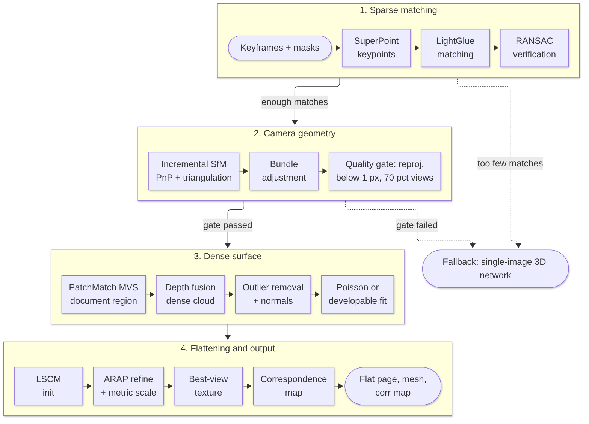

<div align="center">

# FinDoc Guard

**3D-aware cheque and invoice processing with explainable fraud detection**

[](https://github.com/AyushAg310/findoc-guard/actions/workflows/ci.yml)


</div>

FinDoc Guard turns a phone photo or a short video of a cheque or invoice into a validated,
structured record and an explainable fraud report. Its core contribution is a **multi-view 3D
reconstruction module** that flattens folded or curled documents before extraction, while
**preserving the forensic evidence** that tamper detection relies on.

> Computer Vision term project, LNMIIT Jaipur. Only synthetic or consented documents are used.

## Why

Banks and small businesses still key in cheques and invoices by hand. Phone capture makes it
worse: real documents are folded and crumpled, a flat perspective correction can't undo that,
and naive dewarping resamples the image in ways that erase tamper traces.

## Novelty

Existing work covers isolated tasks: LayoutLMv3 receipt extraction, cheque field localization,
document dewarping and tamper detection. FinDoc Guard unifies them into one deployable pipeline:
multi-view 3D reconstruction flattens folded documents while preserving forensic evidence,
template alignment handles cheques, LayoutLMv3 handles invoices, and Indian-format validation
feeds an explainable fraud score.

## Architecture

<p align="center"></p>

<details>
<summary>End-to-end processing flow</summary>
<p align="center"></p>
</details>

<details>
<summary>3D reconstruction and flattening module (CO-5)</summary>
<p align="center"></p>
</details>

Full requirements and design: [`docs/FinDoc_Guard_SRS_SDD.pdf`](docs/FinDoc_Guard_SRS_SDD.pdf).

**Learning guide:** every file is explained, phase by phase, in [`docs/learn/`](docs/learn/README.md).

## Course outcome coverage

| CO | Outcome | Where it's applied |
| --- | --- | --- |
| CO-1 | Image acquisition and processing | Quality scoring, document detection, rectification, illumination correction |
| CO-2 | Deep learning architectures | LayoutLMv3, handwriting OCR, single-image 3D dewarping, tamper forensics |
| CO-3 | Feature detection and matching | SuperPoint + LightGlue, template alignment, duplicate search |
| CO-4 | Motion estimation and tracking | KLT tracking, keyframe selection from video |
| **CO-5** | **3D reconstruction** | **SfM, MVS, meshing, ARAP flattening, forensic evidence mapping** |

## Roadmap

Each phase is a working, demoable increment released as a new minor version.

| Phase | Version | Adds | Status |
| --- | --- | --- | --- |
| 0 | 0.1 | Scaffold: package, CLI, tests, CI, Docker | ✅ Done |
| 1 | 0.2 | Flat-photo pipeline: quality gate, detection, rectification, OCR | ⏳ Next |
| 2 | 0.3 | Cheque understanding: templates, field recognition, amount-in-words, rules | ⬜ |
| 3 | 0.4 | Video + KLT tracking + keyframe selection | ⬜ |
| 4 | 0.5 | 3D reconstruction: SfM + MVS + mesh + ARAP flattening | ⬜ |
| 5 | 0.6 | Fraud engine: tamper mapping, duplicates, signature, risk score | ⬜ |
| 6 | 0.7 | Invoices: LayoutLMv3, GSTIN, invoice arithmetic, Excel export | ⬜ |
| 7 | 0.8 | Product: FastAPI, PostgreSQL, workers, React review UI, Docker Compose | ⬜ |
| 8 | 1.0 | Evaluation, ablations, demo video, term paper | ⬜ |

## Quick start

```bash
git clone https://github.com/AyushAg310/findoc-guard.git
cd findoc-guard
python -m venv .venv
# Windows: .venv\Scripts\activate    macOS/Linux: source .venv/bin/activate
pip install -e ".[dev]"

findoc --help
findoc process path/to/photo.jpg --out outputs/result.json
pytest
```

With Docker:

```bash
docker build -t findoc-guard .
docker run --rm -v "$PWD:/work" -w /work findoc-guard process data/samples/example.jpg
```

## Project structure

```
findoc-guard/
├── findoc/              # Core library
│   ├── pipeline.py      # Stage-based pipeline and process() entry point
│   ├── types.py         # Document, Field, CheckResult models
│   ├── cli.py           # `findoc` command-line tool
│   ├── preprocess/      # Phase 1  quality, detection, rectification   (CO-1)
│   ├── recognize/       # Phase 1-2 OCR, handwriting, MICR, amount parser
│   ├── classify/        # Phase 2-6 doc type and bank template
│   ├── localize/        # Phase 2-6 template alignment, LayoutLMv3     (CO-2, CO-3)
│   ├── track/           # Phase 3  KLT tracking, keyframes              (CO-4)
│   ├── recon3d/         # Phase 4  SfM, MVS, mesh, ARAP flattening      (CO-5)
│   ├── fraud/           # Phase 5  rules, tamper, duplicates, risk score
│   └── export/          # Phase 6  JSON, Excel, annotated images
├── app/                 # Phase 7  FastAPI service
├── frontend/            # Phase 7  React review UI
├── data/                # Synthetic generators and samples (no real documents)
├── experiments/         # Evaluation configs and notebooks
├── docs/                # SRS/design document and diagrams
└── tests/
```

## Tech stack

Python · OpenCV · PyTorch · Hugging Face Transformers (LayoutLMv3) · COLMAP / pycolmap ·
Open3D · SuperPoint + LightGlue · EasyOCR / PaddleOCR · FastAPI · PostgreSQL · Celery + Redis ·
React + three.js · Docker · GitHub Actions

## Responsible use

This is a decision-support tool: a human reviewer makes the final decision. Fraud scores can be
wrong, so every flag shows its evidence and confidence. Only synthetic or consented documents
are processed or stored.

## License

[MIT](LICENSE)
