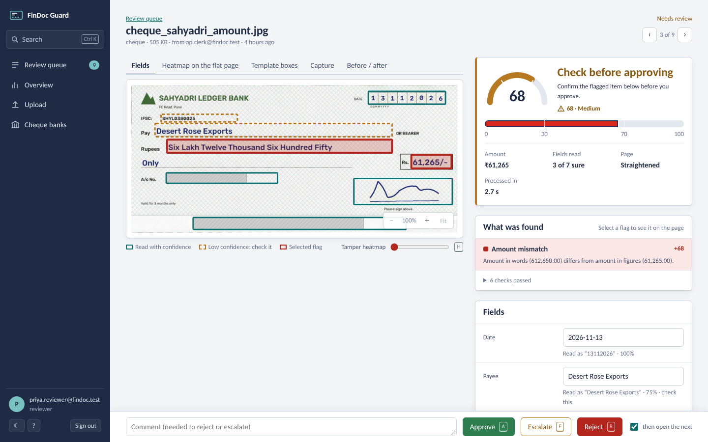
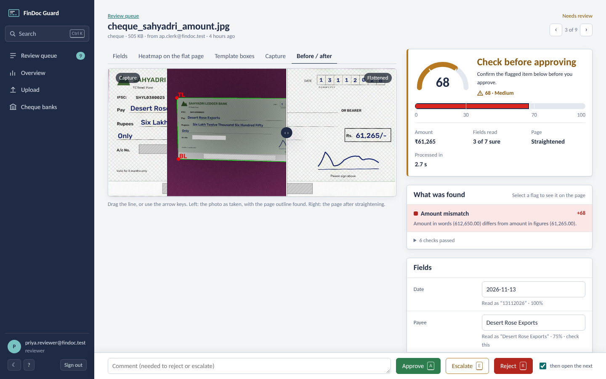

# Phase 8 - The product: API, job queue, database and review UI

**Version 0.9.0.** Until now FinDoc Guard was a command-line tool: one person, one file, one
terminal. This phase turns it into a service a team can use. A clerk uploads photos from a
browser or another system, workers process them in the background, and a reviewer clears the
flagged ones on a screen that shows the evidence beside each flag. Every decision is stored
with who made it and when.



## Why this phase exists

The SRS (section 4.6) asks for review, decisions with an audit trail, exports, a REST API,
role-based access and asynchronous processing (FR-APP-01 to 09). It also has non-functional
targets: security (NFR-SEC), privacy (NFR-PRV), reliability (NFR-REL), a one-command
deployment (NFR-POR-01) and metrics (NFR-OBS-01). None of these is computer vision. They are
what makes the computer vision usable, and they are what an interviewer for a product team
will ask about.

What changed from the SRS plan, and why:

| SRS plan | Built | Why |
| --- | --- | --- |
| Celery + Redis job queue | The `documents` table is the queue (`SELECT ... FOR UPDATE SKIP LOCKED`) | One fewer service to run and secure. PostgreSQL already gives exclusive claiming, retries and durability. Celery doesn't support Windows, where this project is developed. |
| MinIO object storage | A local folder (a Docker volume) behind four functions in `app/storage.py` | Swapping to S3 later changes one file. |
| Alembic migrations | `create_all` at start-up | There is no deployed schema to migrate yet. Alembic comes with the first change to a released schema. |
| bcrypt / argon2 | scrypt from Python's standard library | Also memory-hard, with no extra dependency. |
| TLS on every endpoint | Not in the app | TLS ends at a reverse proxy (Caddy, nginx, a cloud load balancer) in front of the API. This is how it is normally deployed. |
| AES-256 encryption at rest | Not done | Put the database and the storage volume on encrypted disks. Field-level encryption is future work. |
| three.js 3D view, admin template editor, rule sliders | Not built | Rules are read-only at `GET /api/v1/rules` (set with `FINDOC_RISK_*`). Templates are still added with `findoc templates`. |

## 1. Big picture

```
Browser (React)        Other systems (X-API-Key)
      │  HTTPS (behind a proxy)     │
      ▼                             ▼
┌──────────────────── FastAPI (app/main.py) ─────────────────────┐
│ auth (JWT, API keys) · roles · upload checks · RFC 9457 errors  │
│ /api/v1/documents · /exports · /users · /audit · /health · /metrics │
└──────────────┬───────────────────────────────┬─────────────────┘
               │ SQLAlchemy                    │ files
               ▼                               ▼
        PostgreSQL (or SQLite)          storage/documents/<id>/
        users, api_keys, documents      source.png, page.png,
        (= the job queue), decisions,   flat.png, heatmap.jpg ...
        field_edits, exports, audit_log
               ▲
               │ claim (SKIP LOCKED) · progress · result
┌──────────────┴──────────────┐
│ worker processes (app/worker.py) │ x N: run the Phase 1-7 pipeline
└─────────────────────────────┘
```

| Piece | What it does | Files |
| --- | --- | --- |
| Settings | `FINDOC_API_*` environment variables | `app/settings.py` |
| Database | Engine and sessions, tables | `app/db.py`, `app/models.py` |
| Security | Passwords, JWTs, API keys | `app/security.py`, `app/deps.py` |
| Uploads | Size limit, type sniffing, re-encoding | `app/uploads.py` |
| API | Routes and response schemas | `app/routers/*.py`, `app/schemas.py`, `app/main.py` |
| Jobs | Claim, run, retry, progress, redaction | `app/worker.py`, `app/storage.py` |
| CLI | `findoc api serve / worker / create-user / purge` | `app/cli.py` |
| Review UI | React + TypeScript, built by Vite | `frontend/` |
| Deployment | One image, Compose with PostgreSQL | `Dockerfile`, `docker-compose.yml`, `.env.example` |
| Tests | 15 API tests (SQLite and PostgreSQL), 4 UI tests | `tests/test_api.py`, `frontend/src/format.test.ts` |
| Experiment | Queue throughput and exactly-once | `experiments/phase8_queue_eval.py` |

## 2. How a run flows

1. **Start.** `findoc api serve` starts Uvicorn with `app.main:app`. On start-up (`lifespan`)
   it does three things:
   - creates missing tables;
   - creates the first admin from `FINDOC_API_ADMIN_EMAIL` / `_PASSWORD` if the database has
     no users;
   - starts a worker thread unless `--no-worker` is given.

   In Compose the API runs with `--no-worker`, and separate `findoc api worker` containers do
   the work.
2. **Sign in.** The browser posts email and password to `/api/v1/auth/login`. It gets a JWT
   and sends it as `Authorization: Bearer ...` from then on. Systems send `X-API-Key` instead.
3. **Upload.** `POST /api/v1/documents` checks the file:
   - type, from the file's bytes;
   - size;
   - for images, that it decodes, and it saves them again as PNG.

   It then stores the file under `storage/documents/<id>/source.*`, inserts a `documents` row
   with status `queued`, writes an audit entry and answers **202 Accepted** with the id.
4. **Work.** A worker claims the oldest queued row (status `processing`, attempts + 1) and runs
   the same pipeline as `findoc process`. After each stage it writes the stage name and
   progress to the row, so the UI's progress bar moves. At the end it:
   - renders the review images, with the account number and MICR covered;
   - stores the result JSON;
   - sets the status: `needs_review` for medium or high risk, `processed` for low,
     `rejected_quality` if the photo was unusable. An error puts the job back to `queued`, up
     to 3 attempts, then `failed`.
5. **Review.** The reviewer opens the queue, then a document:
   - corrects fields (`PATCH .../fields`);
   - approves, rejects or escalates (`POST .../decision`). A rejection or escalation needs a
     comment, and an admin decides escalated documents.

   Each action adds a row to `field_edits` or `decisions` and to `audit_log`.
6. **Export.** `POST /api/v1/exports` writes JSON or Excel with the corrections applied and
   account numbers masked. `GET /api/v1/exports/<id>` downloads it.

Document states (SRS 9.3):

```
queued ──► processing ──► needs_review ─┬─► approved
  ▲             │         processed ────┼─► rejected
  └── retry ◄───┤ (attempts < 3)        └─► escalated ──► approved / rejected (admin)
                ├──► failed  (after 3 attempts; "retry" queues it again)
                └──► rejected_quality  (photo unusable: ask for a retake)
```

## 3. File-by-file walkthrough

### 3.1 `app/settings.py`

A second `BaseSettings` class with prefix `FINDOC_API_`, kept apart from the pipeline's
`FINDOC_*` settings, so the CV code never depends on web settings. Points worth knowing:

- `database_url` defaults to SQLite in `data/findoc.db` (one machine, nothing to install).
  Compose sets `postgresql+psycopg://...`.
- `jwt_secret` defaults to a random value made at start-up. That's safe but logs everyone out
  on restart, so a deployment sets it.
- `inline_worker`, `max_attempts` (3, NFR-REL-02), `stale_minutes`, `retention_days` (30,
  NFR-PRV-01) and `max_upload_mb`.
- `ocr="auto"` turns OCR on when EasyOCR is installed.

### 3.2 `app/db.py` and `app/models.py`

SQLAlchemy 2.0 style: `DeclarativeBase`, typed `Mapped[...]` columns. SQLite gets two pragmas
at each connection:

- `journal_mode=WAL`, so the UI can read while a worker writes;
- `foreign_keys=ON`, which is off by default in SQLite.

The tables (SRS 11.1):

| Table | Holds |
| --- | --- |
| `users` | email, role (`submitter` < `reviewer` < `admin`), scrypt hash, active flag |
| `api_keys` | prefix (to find the row) and SHA-256 of the key, never the key |
| `documents` | the upload, the job state (status, attempts, stage, progress, error) and the result |
| `field_edits` | each correction: field, old value, new value, who, when |
| `decisions` | approve / reject / escalate, comment, who, when |
| `exports` | what was exported, by whom, how many rows |
| `audit_log` | append-only: actor, action, target, details |

A document row stores several kinds of data:

- the result (`result`, a JSON column);
- the reviewer's corrections, kept beside the result rather than replacing it (`corrections`);
- the names of its rendered images (`images`);
- columns copied out of the result so filters and counts are plain indexed SQL (`risk_band`,
  `doc_type`, `risk_score`).

`DocStatus` lists the states drawn above. `OPEN_FOR_REVIEW` = `needs_review` and `processed`.

### 3.3 `app/security.py` and `app/deps.py`

- **Passwords:** `hashlib.scrypt` with a random 16-byte salt, stored as
  `scrypt$n$r$p$salt$hash`. A stored hash carries its own cost, so the cost can be raised
  later. Checking uses `hmac.compare_digest`, which takes the same time whether the first or
  the last byte differs.
- **JWT:** HS256 with `sub` (user id), `role`, `iat` and `exp`. The server re-reads the user on
  every request, so disabling a user locks them out at once, even with a valid token. A test
  checks this.
- **API keys:** `fdk_<8 hex prefix>_<43 random chars>`. The prefix finds the row, and the
  SHA-256 is compared in constant time. A fast hash is right here: the key is 256 random bits,
  so there's nothing to brute-force. Passwords need a slow hash because people choose them.
- **`require(role)`** is a FastAPI dependency factory. `Depends(require(Role.REVIEWER))` on a
  route lets reviewers and admins in. Everyone else gets **403**; a caller who isn't signed in
  gets **401**.
- **`audit(...)`** adds an `AuditLog` row in the same transaction as the change it records, so
  you can't have one without the other.
- **Login** compares against a dummy hash when the email is unknown. Without that, a wrong
  email would answer faster than a wrong password and reveal which emails have accounts.

### 3.4 `app/uploads.py`: never trust an upload (NFR-SEC-05)

- **Type from magic bytes, not from the name or Content-Type.**
  - JPEG starts `FF D8 FF`;
  - PNG `89 50 4E 47 0D 0A 1A 0A`;
  - MP4/MOV have `ftyp` at byte 4;
  - AVI and WebP are RIFF containers.

  Anything else is refused with a message listing what is accepted.
- **Images are decoded and written again as PNG.** That removes EXIF (GPS location, camera
  serial) and anything hidden after the image data, and a file that doesn't decode is refused.
  PNG is lossless, so the decoded pixels are kept exactly, including the 8×8 JPEG block traces
  the tamper model reads. So this step doesn't weaken forensics. OpenCV applies the EXIF
  rotation while decoding, so phone photos stay upright.
- **Size limits:** at most `max_upload_mb` bytes are read, and images must be 200 to 12,000
  pixels a side (12,000 stops "decompression bombs": tiny files that decode to gigabytes).
- **Filenames** are reduced to letters, digits, `.`, `-`, `_` and spaces, and are only ever
  shown, never used as a path. A test uploads `../../etc/cheque 1.jpg`.

### 3.5 `app/routers/documents.py`

- **Object-level access (OWASP API #1).** `get_visible` returns a document only to its owner
  or to a reviewer or admin. For anyone else it answers **404, not 403**, so ids can't be
  probed to learn which exist.
- `POST ""` → 202. It also reports `duplicate_of` when the same user uploaded the same bytes
  before (SHA-256), which catches double-submissions.
- `GET ""` lists with filters: several `status` / `band` values, `doc_type`, filename search,
  date range, paging. The total is counted with the same filters.
- `GET /stats` gives counts for the dashboard and is open to reviewers.
- `GET /{id}` returns the detail. `detail()` builds it from the stored result:
  - **account number and MICR masked** to their last 4 digits (NFR-PRV-01);
  - each check's points (`contribution`) attached from the risk breakdown;
  - submitters get only the first line of an error, not a traceback;
  - `allowed_decisions` tells the UI which buttons to show. The server enforces the same rule
    again on `POST /decision`.
- `GET /{id}/image?variant=` serves the rendered images. `variant` is checked against a fixed
  list by a regex in the query declaration (422 otherwise).
- `PATCH /{id}/fields` (reviewer):
  - refuses unknown field names;
  - writes one `FieldEdit` and one audit entry per changed field, masking account digits in
    the audit too;
  - keeps the pipeline's own reading.
- `POST /{id}/decision`: 409 for a document in the wrong state; 403 when a reviewer tries to
  decide an escalated one; 422 when a reject or escalate has no comment.
- `POST /{id}/retry` puts a failed document back in the queue. `DELETE /{id}` (admin) erases it
  and its files on request (DPDP Act); the audit log keeps that it existed.

### 3.6 `app/routers/other.py`

Auth (`/login`, `/me`), users (admin), your own API keys, the audit log (admin), the risk
rules in force, exports, `/health` and `/metrics`.

- An admin can't demote or disable themself, so there's always one admin left.
- `export_record()` is what leaves the system:
  - corrections replace the values, marked `method: "reviewer"`;
  - account numbers are masked;
  - the OCR word list is dropped;
  - decisions are attached.

  Excel reuses Phase 7's `write_workbook`.
- `/metrics` is Prometheus text: request counts and time per route, documents per status, and
  per-stage latency over the last 500 documents. It is written by hand because it's six kinds
  of line and needs no library. In production it's reachable only on the internal network.

### 3.7 `app/main.py`

- `create_app()` makes the app, so tests can build a fresh one after changing settings.
- **Errors are RFC 9457 problem details**:
  `{"type", "title", "status", "detail", "instance"}` with content type
  `application/problem+json`, for every error, including validation (422 lists the fields).
  Unhandled exceptions are logged and answered with a generic 500, never a stack trace.
- A middleware adds `X-Content-Type-Options: nosniff`, `X-Frame-Options: DENY` and
  `Referrer-Policy: no-referrer`, and records the metrics.
- `mount_frontend` serves the built React app. Any non-API path returns `index.html`, so a
  reload on `/documents/abc` works. `is_relative_to` stops `/../../etc/passwd` from reading
  outside the folder (tested).

### 3.8 `app/worker.py`: the queue

**Claiming** is the heart of it:

```python
q = select(Document.id).where(Document.status == "queued").order_by(Document.created_at).limit(1)
if dialect == "postgresql":
    q = q.with_for_update(skip_locked=True)
...
UPDATE documents SET status='processing', attempts=attempts+1 WHERE id=:id AND status='queued'
```

On PostgreSQL, `FOR UPDATE SKIP LOCKED` locks the row it picks. A second worker running the
same query at the same moment skips the locked row and takes the next one, so it neither
waits nor takes the same job. SQLite has no row locks. There, the `UPDATE ... WHERE
status='queued'` is a compare-and-set: if two workers raced, only one changes the row
(`rowcount == 1`) and the other tries again. The `WHERE status='queued'` is kept on PostgreSQL
too, as a second safety net.

- **Retries:** any exception, or a pipeline stage that failed, sends the job back to `queued`
  until `attempts == max_attempts`. Then it's `failed` with the error kept (NFR-REL-02: no
  silent data loss).
- **Crash recovery:** a job still `processing` after `stale_minutes` belonged to a worker that
  died (power cut, container killed). `requeue_stale` puts it back; each worker sweeps once a
  minute.
- **Progress:** `Pipeline.run` now takes `on_stage(name, i, total)` (a 6-line change in
  `findoc/pipeline.py`). The worker writes it to the row in its own short transaction.
- **Redaction** (`REDACT`, `redaction_quads`, `_cover`): the API masks the account number in
  JSON, but the page image would still show it. So the worker covers the account-number box
  (left 72%) and the MICR line (left 80%) in every image it renders. The boxes are in template
  coordinates, so they are mapped to each image:
  - page and annotated images: as they are;
  - flat page and heatmap: through the inverse template homography;
  - the capture: through the inverse homography after that.

  When the page was flattened in 3D there is no single homography back to the capture, so the
  capture isn't saved at all. The uploaded source isn't redacted (it's needed to re-run) and
  is deleted by `findoc api purge` after the retention period.

### 3.9 `app/cli.py`

`findoc api serve` (Uvicorn; `--no-worker` for Compose), `findoc api worker` (`--once` to
drain the queue and exit), `findoc api create-user` (asks for the password twice) and
`findoc api purge` (`--dry-run`). FastAPI is imported inside the commands, so `findoc --help`
works without the `[api]` extra.

### 3.10 `frontend/`: the review UI

React 18 + TypeScript, built by Vite into `frontend/dist`, which FastAPI serves. No UI library:
the screens are plain components and one stylesheet.

| File | What |
| --- | --- |
| `src/api.ts` | Typed client. The token lives in `sessionStorage` (gone when the tab closes). On 401 it signs out. Images are fetched as blobs, because `` can't send the `Authorization` header. |
| `src/auth.ts`, `src/main.tsx` | Who is signed in, routes per role (submitters see only their uploads), the side rail with the open-review count |
| `src/pages/Queue.tsx` | Counts in one line, filter chips kept in the URL (shareable, survives reload), table, paging, Excel / JSON export. Refreshes every 5 s. |
| `src/pages/Upload.tsx` | Drop zone, cheque options, recent uploads with a live stage label ("Matching the cheque template") |
| `src/pages/Review.tsx` | The main screen (described below) |
| `src/pages/Admin.tsx` | Users and roles, your API keys (shown once), the audit trail |
| `src/format.ts` (+ test) | Labels, Indian digit grouping (12,34,567.50), "3 minutes ago", which fields a check is about |

The review screen:

- **Left:** the page as an SVG, with the image and one `<rect>` per field box in image pixel
  coordinates (`viewBox` = the image size, so boxes stay aligned at any width). The box
  outline shows confidence: solid teal = read confidently, dashed amber = check it.
- **Right:** the risk score, the checks (fired first, by points), the editable fields, line
  items and history.
- **Clicking a flag** lights up its region on the page in red. Amount mismatch lights both
  amounts; a tamper flag switches to the heatmap. This is SRS principle 12: evidence next to
  the claim.
- **Keyboard:** **A** approve, **E** escalate, **R** reject, ignored while typing in a field.
  E and R ask for a comment first.
- **Accessibility:** risk and status always pair colour with an icon or word (WCAG 1.4.1),
  focus rings are visible, and the layout works down to a phone width.

### 3.11 `Dockerfile`, `docker-compose.yml`, CI

- **Multi-stage image:** stage 1 (`node:22-alpine`) builds the UI; stage 2 (`python:3.11-slim`)
  installs the package and copies only `dist/`. Node isn't in the final image.
  - `--build-arg EXTRAS=api,ocr` adds EasyOCR with CPU PyTorch (the extra index avoids the 2 GB
    CUDA wheels).
  - The container runs as a non-root user and has a health check on `/health`.
- **Compose:** `db` (PostgreSQL 16 with a health check), `api` and `worker`, sharing one image
  and the storage volume.
  - `docker compose up --scale worker=3` runs three workers.
  - Your trained models are mounted read-only from `./models`.
  - Secrets come from `.env` (template: `.env.example`; `.env` is git-ignored).
- **CI** now has four jobs:
  - lint + tests on Python 3.10-3.12;
  - the API tests again on a real PostgreSQL service;
  - the UI (`npm ci`, `npm test`, `npm run build`);
  - the Docker build plus a smoke test that starts the API and fetches `/health` and the UI.

### 3.12 Results

**End-to-end** (PostgreSQL, EasyOCR on CPU, 2-core sandbox; times from the `documents`
table):

| Document | Status | Risk | Processing |
| --- | --- | --- | --- |
| Clean cheque | processed | 0 low | 2.5 s (13.8 s for the first job: OCR model loading) |
| Amount words ≠ figures | needs_review | 66 medium, Amount mismatch | 2.5 s |
| Post-dated cheque | needs_review | 36 medium | 2.3 s |
| Unsigned cheque | needs_review | 60 medium, Signature missing | 2.6 s |
| Clean invoice | processed | 0 low | 15.5 s |
| Invoice with a wrong total | needs_review | 39 medium, Invoice math | 14.4 s |

NFR-PER-01 asks for a single photo in at most 20 s on a CPU. Cheques take 2-3 s; invoices take
15 s, almost all of it full-page OCR.

**Queue** (`experiments/results/phase8_queue.json`): 500 synthetic cheques queued in
PostgreSQL and drained by worker processes (OCR off, 2-core machine):

| Workers | Time | Per minute | Speed-up | Jobs per worker | Every document exactly once |
| --- | --- | --- | --- | --- | --- |
| 1 | 750 s | 40.0 | 1.00 | 500 | yes (500 attempts, 500 audit entries) |
| 2 | 381 s | 78.8 | **1.97** | 244 / 256 | yes |

Two workers are almost exactly twice as fast. The claim costs a few milliseconds against
1.5 s of CV per cheque, so the queue isn't the bottleneck; the CPU cores are. NFR-SCL-01 asks
for linear scaling up to 4 GPU workers. This machine has 2 cores, so run the same script with
`--workers 1 2 4` on a bigger one to test 4. NFR-SCL-02 (500 queued without failure) is met:
no job failed, was lost or ran twice.

**Tests:** 15 API tests and 4 UI tests. The API tests pass on SQLite and on PostgreSQL 16. Core
coverage stays above 90%.

### 3.13 v0.9.1: the review desk upgrade, more banks, the template editor

**Frontend files added:**

| File | What |
| --- | --- |
| `src/ui.tsx` | Theme (light/dark, remembered, follows the system by default), toasts, a reusable `Dialog` (focus moves in, Esc closes, focus returns), the **command palette** (Ctrl/Cmd+K: documents searched as you type, plus commands; arrow keys + Enter; ARIA combobox), the shortcuts dialog, global keys, and `reviewList`, the queue order the review screen steps through |
| `src/components/ZoomCanvas.tsx` | Pan and zoom with one CSS transform: `translate(x, y) scale(s)`. Zooming at the pointer keeps the point under it still: `x' = px − (px − x)·k`. Wheel events need a native listener with `{passive: false}`, because React's are passive and can't stop the page scrolling. A drag of more than 4 px is a pan, not a click on a field box. |
| `src/components/charts.tsx` | Three SVG charts, no library: grouped bars per day, a risk histogram coloured by band, horizontal bars. Each has an `aria-label` with the numbers and a hover readout. |
| `src/pages/Overview.tsx` | The operations page |
| `src/pages/Templates.tsx` | Bank cards and the **template editor**. Boxes are stored as fractions of the image (0..1), so the editor works at any image size. Pointer positions are mapped into SVG coordinates with `getScreenCTM().inverse()`. Drag moves a box, the corner handle resizes it, the arrow keys nudge the selected one. |

**What changed in the existing screens:**
- **Queue:** sorting (state in the URL, so it survives reloads and can be shared), checkboxes
  only on documents that can still be decided, and a bulk bar. A rejection or escalation asks
  for one comment, saved with every document.
- **Review:**
  - **Heatmap overlay.** The worker now also saves `overlay.png`, the tamper map as a
    transparent BGRA image warped into the same frame as `page.png` (template coordinates for
    a cheque). The browser lays it over the page with an opacity slider, so a reviewer sees
    the suspicious region on the fields themselves.
  - **Navigation.** "Then open the next" moves on after a decision, and the toast has a "Go
    back" link.
- **Upload:** files go up with `XMLHttpRequest`, because `fetch` can't report upload progress.
  `capture="environment"` opens the phone's back camera.
- **Lazy loading:** pages few people open (Overview, banks, admin) are separate bundles, loaded
  on demand with `React.lazy`.

**Banks** (`findoc/synth/cheque.py`): `BankStyle` gains `pattern` (`waves`, `rosette`, `mesh`,
`dots`) and `branch`, and there are four new logo shapes. The names are invented on purpose:
synthetic look-alikes of real banks' cheques are how forgeries start, so real banks come in
only as local templates. With 12 banks, all 144 synthetic test photos were identified
correctly.

**Template store** (`findoc/localize/templates.py`):
- `default_store` now merges the built-in banks with the custom folder. Before, any custom
  template hid all the built-ins.
- `custom_store` caches the folder and re-reads it only when a `template.json` changes (the key
  is the files' modification times).
- `ChequeTemplate.scaled()` brings every template to 1624 px wide, because registration
  compares a photo with all templates at one scale.

**Templates API** (`app/routers/templates.py`):
- Upload checks: an image that decodes, a leaf-like aspect ratio (1.6 to 2.8), a 4-letter code
  that isn't a built-in, known field names, and the five fields the cheque checks need.
- Kind, character allowlist and date cells come from the standard layout by field name, so the
  admin only places boxes.
- A personalised leaf carries the holder's account number, so template images are served with
  the same redaction as document images.

**Video tamper fix** (`findoc/fraud/stages.py`): your real cheque video scored 1.00 on the
tamper check and was sent to review as high risk. The model was trained on JPEG
re-compression traces, but a video frame has been through H.264, so every block looks
"different". For video input the check is now `fired=False` with a reason, and the heatmap is
kept for a person to look at. The honest fix is a tamper model trained on video frames (future
work).

**Cost of more banks.** Identification compares SIFT features with every template, so time
grows linearly with the number of banks: about 0.2 s with 4 on a laptop, about 1 s with 12-13
on a 2-core machine. With many banks you would shortlist first, for example with a global
descriptor (colour histogram, or a small CNN embedding), then run SIFT only on the top few.

### 3.14 v0.9.2: results first

The question a reviewer brings to every screen is "what's the answer, and why?". Before 0.9.2
the answer was there (a score, a band, a list of checks), but the reviewer had to assemble it.
This version puts the result first on every page and keeps the evidence one click away.



**API (additive only: no field was removed or renamed, so old clients keep working):**

| Where | New field | How it is computed |
| --- | --- | --- |
| Document summary (`summary()` in `app/routers/documents.py`) | `top_flags` | Fired checks from the stored result, joined with their points from `risk.contributions`, sorted by points, first 3 (`_top_flags`) |
| Document summary | `amount` | `_amount`: a reviewer's numeric correction of `amount_figures` or `total` wins; otherwise the checked (normalised) value; never the raw OCR text |
| `GET /documents/stats` | `value_flagged`, `value_rejected` | Sum of amounts over the last 1000 processed documents scored medium/high, and over those a reviewer rejected |
| `GET /documents/stats` | `agreement`, `agreement_n` | Share of decided documents where the reviewer agreed with the band: a flagged document stopped (rejected or escalated), or a low one approved |
| `GET /documents/stats` | `median_decision_minutes` | Median of `decided_at - finished_at` |

Summaries are built from the `result` JSON already stored per document, so the queue needs no
new query and no migration. `test_results_in_summaries_and_outcome_stats` checks each number,
including that a correction like "lots" is ignored.

**Frontend:**

| File | What |
| --- | --- |
| `src/components/results.tsx` (new) | `ScoreGauge` (a half-circle SVG arc whose `stroke-dashoffset` is `length × (1 − score/100)`; the number counts up with `requestAnimationFrame` and an ease-out curve, instantly with reduced motion), `ScoreRing`, `RiskBreakdown`, `PipelineSteps`, `BeforeAfter` |
| `src/format.ts` | `verdictFor` (band → title and advice), `PIPELINE_STEPS` and `stepIndex` (the 17 stages grouped into 6 steps), `compactRupees` (₹2,500, ₹6.13 L, ₹2.5 Cr). Plain functions, unit-tested in `format.test.ts` |
| `src/pages/Review.tsx` | `VerdictCard` replaces the score box; one `pickCheck` handles clicks from a breakdown segment and from a check row, so both highlight the same fields; a "Before / after" tab when both the capture and the flat page exist |
| `src/pages/Upload.tsx` | `ResultCard`: one card per file, from upload progress to steps to the result. The cards read the same polled list as the table below, so there are no extra requests |
| `src/pages/Queue.tsx`, `Overview.tsx`, `components/charts.tsx` | "Why flagged" chips and "Amount"; the Outcomes row and the `Donut` chart |

**How the pieces work:**
- **Breakdown bar.** Each segment's width is its points as a share of the bar. Contributions can
  add up to more than 100 (the score is capped at 100), so the segments are scaled to the
  score. The 30 and 70 band edges are drawn on top, so you can see which check pushed the
  document over a line. Each segment is a `<button>` with a hidden text label, so it works from
  the keyboard and with a screen reader.
- **Same colour, same check.** Segment colours come from CSS variables `--seg1..4`. The check row
  with the same rank shows a matching swatch, so the bar works as a legend without a separate
  legend.
- **Steps.** The worker already writes the current stage to the row for the progress bar. The
  UI maps that stage name to one of six steps. No new server work was needed.
- **Before / after.** Two images in one box, both `object-fit: contain`. The capture is on top,
  clipped with `clip-path: inset(0 X% 0 0)`. An invisible full-size `<input type="range">` sits
  over them, so dragging, clicking and the arrow keys all work, and it is announced as a slider.
  For a cheque flattened in 3D no capture image is saved (the account number can't be covered
  reliably through a non-planar mapping), so the tab doesn't appear.
- **Suggested action.** The text follows the band and `forced_by` only. It never says
  "approved": the reviewer decides, and every decision is still audited.

**Why "agreement" and not "accuracy".** There is no ground truth in production, only the
reviewer's decision. Agreement says how often the risk score and the reviewer pointed the same
way. Watched over time, a drop means a new kind of document or a drifting threshold. It is not
a claim that the model is right.

## 4. Concepts used in this phase

- **REST and status codes.**
  - 200 OK, 201 Created, 202 Accepted ("I'll do it later": the processing is asynchronous),
    204 No Content;
  - 401 = we don't know who you are, 403 = we know and you may not, 404 = not found (or not
    yours), 409 = conflicts with the current state, 422 = the request is malformed.
- **Authentication vs authorisation.** Authentication proves identity (password, JWT, API
  key). Authorisation decides what that identity may do (roles at the route, ownership at the
  object). Most real breaches are broken authorisation, not broken passwords.
- **JWT.** A signed JSON claim set: header, payload, signature. The server checks the
  signature with its secret instead of looking up a session. The trade-off: a JWT can't be
  revoked before it expires, so this server re-checks the user's `active` flag on every
  request.
- **Hashing: slow vs fast.** Passwords are low-entropy, so a slow, memory-hard hash (scrypt)
  makes guessing expensive. API keys are high-entropy random strings, so SHA-256 is enough.
- **Database as a queue.** The pieces a queue needs:
  - an exclusive claim (row lock + `SKIP LOCKED`);
  - visibility (the status column);
  - retries (an attempts counter);
  - durability (it's in the database).

  A broker such as Redis or RabbitMQ is worth it at thousands of jobs per second. Documents
  that take seconds each are nowhere near that.
- **At-least-once vs exactly-once.** A worker could finish a job and die before writing the
  result. The job is then requeued and runs again, so the guarantee is at-least-once. The
  pipeline is deterministic (NFR-REL-03), so a re-run gives the same result: the job is
  *idempotent*, and that is what makes at-least-once safe.
- **ORM.** SQLAlchemy maps Python classes to tables and builds SQL portably. The one dialect
  difference that matters here is row locking.
- **Single-page app.** The server sends one HTML file and a JS bundle, and React draws every
  screen in the browser, calling the JSON API. Client-side routes (`/documents/abc`) need the
  server to return `index.html` for unknown paths.
- **Defence in depth.** Each protection works without relying on the next one:
  - the UI hides the decision buttons, and the server refuses the decision anyway;
  - the JSON masks the account number, and the images cover it too.
- **12-factor configuration.** Settings come from environment variables, secrets aren't in
  the code, and one image is configured per environment.

## 5. Try it yourself

1. **Run it on your laptop** (no Docker needed):
   ```
   pip install -e ".[api,ocr]"
   cd frontend && npm ci && npm run build && cd ..
   findoc api create-user --email you@example.com --role admin
   findoc api serve
   ```
   Open http://127.0.0.1:8000, sign in, upload `demo` photos or a `findoc synth` cheque, and
   watch it move through the stages.
2. Open http://127.0.0.1:8000/docs. Click **Authorize**, use your email and password, and call
   `GET /api/v1/documents` from the browser. Then create an API key in the UI and use it with
   curl:
   `curl -H "X-API-Key: fdk_..." -F file=@cheque.jpg http://127.0.0.1:8000/api/v1/documents`.
3. Create a submitter and a second submitter. Upload as the first and try to open that
   document's URL as the second. What do you get, and why not 403?
4. Stop the server while a video is processing (Ctrl+C), start it again with
   `FINDOC_API_STALE_MINUTES=0`. What happens to the job?
5. **Queue scaling:** with Docker Desktop, `docker compose up --build`. Then run
   `python experiments/phase8_queue_eval.py --db <the compose database URL> --n 200 --workers 1 2 4`.
   Where does the speed-up stop growing, and how many cores does your laptop have?
6. Change `REDACT["account_number"]` to `1.0`, reprocess a cheque, and look at the page image.
   Which test fails, and what does it check?

7. Press **Ctrl K**, type part of a file name, press Enter. Then open a cheque, press **H**,
   and drag the heatmap slider. Scroll on the page to zoom and drag to move.
8. As an admin, open **Cheque banks → Add a bank**. Upload a scan of a blank leaf (cover the
   account number first if it's personalised), move the boxes onto the fields, and save.
   Upload a filled cheque of that bank: which template does the processing log say matched,
   and with how many inliers?

## 6. Viva and interview questions

**Q: Why is the upload answered with 202 and not the result?**
Processing takes 2-60 s (a video needs 3D reconstruction). Holding the HTTP request open that
long ties up a server worker, hits proxy timeouts and fails if the connection drops. So the API
accepts the job, returns an id, and the client polls the status. The UI shows the stage while
it waits.

**Q: How do two workers avoid processing the same document?**
On PostgreSQL the claim is `SELECT ... FOR UPDATE SKIP LOCKED`. The first worker locks the row
it selects, and the second skips locked rows and takes the next. The status update also has
`WHERE status = 'queued'`, a compare-and-set: on SQLite, which has no row locks, that alone
decides who wins. The load test checks it: N documents, N attempts, N "processed" audit
entries.

**Q: Why not Celery?**
The queue needs four things: an exclusive claim, retries, visibility of state, durability.
PostgreSQL already does all four, and using it means one fewer service to deploy, monitor and
secure. Celery also doesn't run on Windows. Past thousands of jobs per second, or with complex
workflows (chains, fan-out), a broker becomes worth it.

**Q: A worker crashes halfway. What happens?**
The row stays `processing`. After `stale_minutes`, any worker's sweep puts it back to `queued`
and it runs again. That's at-least-once delivery. It's safe because processing is idempotent:
same input, same models, same result, and results overwrite rather than append.

**Q: How do you stop one customer reading another's documents?**
Two layers. Routes check the role (`require(Role.REVIEWER)`). Every document lookup checks
ownership (`get_visible`) and returns 404 for someone else's document. Testing only the role
misses the second layer, which is OWASP's number one API risk, so there's a test where a
second submitter tries.

**Q: Why scrypt for passwords but SHA-256 for API keys?**
Passwords are guessable, so each guess should cost memory and time. An API key is 256 random
bits: nobody can guess it, so a fast hash loses nothing and keeps every request cheap.

**Q: The account number is masked in the API. Is that enough?**
No. The page image shows it too, so the worker covers it in every rendered image, mapped
through the same homographies the pipeline computed. When the page was flattened in 3D there's
no homography back to the capture, so that image isn't kept. The original upload stays
unredacted for re-processing and is deleted after the retention period.

**Q: Doesn't re-encoding uploads destroy the forensic traces?**
Re-encoding to JPEG would. Saving to PNG doesn't: PNG is lossless, so every decoded pixel,
including the JPEG blocking the tamper model analyses, is kept exactly. What's dropped is
metadata and anything appended to the file.

**Q: What would you change for production at a bank?**
- TLS at a proxy, and single sign-on (OIDC) instead of local passwords.
- Alembic migrations, and field-level encryption for account numbers.
- S3 storage with object lock for audit evidence, and rate limits on login.
- Alerting on `/metrics`.
- A separate audit store that application admins can't modify.

**Q: Why did you keep reviewer corrections beside the result instead of overwriting it?**
So you can always see what the machine read and what a person changed. That's the audit
requirement, and it is also training data: every correction is a labelled error for the next
model.

**Q: How does the zoom keep the point under the mouse still?**
The content is drawn with `translate(x, y) scale(s)`. A screen point p shows the content point
(p − x) / s. After zooming by k, that content point must stay at p, so the new offset is
x' = p − (p − x)·k. This is the same "zoom about a point" algebra as an affine transform in
image processing.

**Q: Why add the bank through a template and not by training a model?**
A cheque leaf is a fixed layout. One blank image plus 9 boxes is enough for SIFT + RANSAC to
register any photo of that bank and read each field from its box. No training data, and it
works the moment it's saved. A learned detector would need many labelled photos per bank.

**Q: Your overview says reviewers agreed with the score 100% of the time. Is the model perfect?**
No. Agreement isn't accuracy: there is no ground truth in production, only the reviewer's
decision, and a reviewer may simply trust the score. It is a monitoring number: if it drops,
something changed (a new bank layout, a new fraud pattern, a threshold that no longer fits).
Accuracy is measured offline on labelled data, as in the phase results.

**Q: How does the score breakdown stay honest when contributions add up to more than 100?**
The score is capped at 100, so the bar scales the segments to the score rather than to their
sum. The order and relative sizes stay right, and the band lines (30, 70) show which check
pushed the document over. A finding that forces "high" on its own is named under the bar.

**Q: Why did you add fields to the summary instead of making the UI fetch each document?**
A queue of 100 rows would mean 100 detail requests. The summary is built from the result JSON
that is already loaded for the row, so `top_flags` and `amount` cost no extra query, and the
change is additive: existing API clients ignore the new fields.
